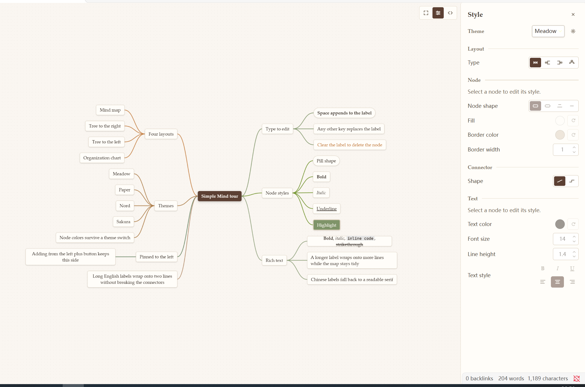
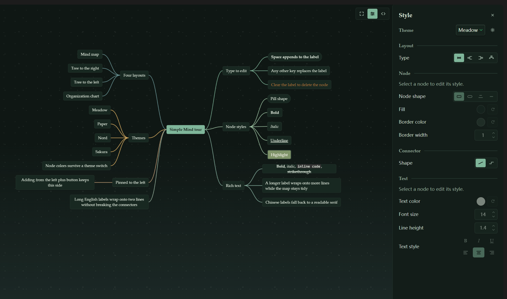

# Simple Mind

A Markdown-outline mind map editor for Obsidian.

[github.com/fickit/simple-mind](https://github.com/fickit/simple-mind)

> Status: 1.1.1

Simple Mind turns a plain `.mindmap` file into a polished, interactive map — and keeps it a plain
Markdown outline underneath. No account, no lock-in.





## Why Simple Mind

- **Free, all of it.** Four layouts, nine themes.
- **Beautiful by default.** Nine hand-tuned themes, from a warm Natural Organic light mode to a
  moonlit-forest dark mode, and the map follows Obsidian's light/dark switch on its own.
- **Complete, not a toy.** Four layouts, inline editing, drag to reorganize, collapse, undo/redo,
  clipboard, per-node styling, inline images and note links, a custom theme editor, and per-file view
  state.
- **Fast and quiet.** No telemetry, and the plugin itself makes no requests. Redraws are frame-batched
  and off-screen nodes are culled, so maps with hundreds of nodes stay responsive. External images
  you embed are loaded by Obsidian's image renderer.
- **Your data stays yours.** A `.mindmap` file is Markdown plus a small frontmatter block; it opens
  in the source editor at any time and syncs like any other note.

## Features

### Maps that fit the way you think

- Four layouts: mind map, tree to the right, tree to the left, and organization chart.
- Inline editing, drag to reorganize, copy and paste subtrees, undo and redo.
- Collapse a branch into a count bubble; add buttons follow the layout and remember which side a
  branch belongs to.
- Drag on empty canvas to box-select nodes; the box and the covered nodes highlight live
  (Ctrl/Cmd/Shift adds). Alt+drag pans the canvas; Ctrl/Cmd+A selects all; drag the root node to move
  the whole map, and drag a child onto another node to reparent it.
- Each file remembers its pan, zoom, and selected node.

### Linked to your vault

- Put note links and image embeds straight into a label: `[[Note]]`, `[[Note|alias]]`,
  `![[photo.png]]`, or `![[photo.png|300]]`.
- Images render as thumbnails capped at 140 px high; add `|300` to set a width. A node made only of
  images drops its card and becomes the picture itself, with rounded corners. Click one to open it
  in a full-map lightbox.
- Note links open in a new tab, keep the map open, and show Obsidian's page preview on hover.
- Typing `[[` or `![[` while editing opens a fuzzy file search that inserts the link for you.

### Styling without a design degree

- One style panel for the file's theme, layout, and connector shape, plus the selected node's shape,
  fill, border, and text styling (size, color, bold, italic, underline, alignment, line height).
- Nine built-in themes: Meadow, Obsidian Native, Paper, Graphite, Nord, Solarized, Forest, Ocean, and
  Sakura.
- A custom theme editor with a live preview, and theme import/export.
- A line node puts its label above the branch line itself: the line is the node body, shares the
  connector's color and width, and carries into its child branches.
- Font family, connector color, and connector thickness are global defaults in the settings tab.

## Usage

1. **Create a map.** Click the ribbon icon or run the **New mind map** command. An existing Markdown
   outline also works — just rename it to `.mindmap`, or open any note as a map from the tab's
   three-dot menu.
2. **Type directly.** With a node selected:
   - **Space** appends to the current label.
   - **Any other character** replaces the label with what you typed.
   - **Clear the whole label** and commit to delete the node (the root keeps at least one character).
3. **Keys.**

   | Key | Action |
   | --- | --- |
   | `Tab` / `Enter` | Add a child / add a sibling |
   | `F2` or double-click | Edit the selected node |
   | `Delete` / `Backspace` | Delete the selected node, except the root |
   | Arrow keys | Move the selection |
   | `Ctrl/Cmd+A` | Select all visible nodes |
   | Drag on empty canvas | Box-select nodes; Ctrl/Cmd/Shift adds |
   | Alt + drag | Pan the canvas |
   | Drag the root node | Move the whole map |
   | Drag a child node | Reparent it onto another node |
   | `Ctrl/Cmd+Z`, `Ctrl/Cmd+Shift+Z` | Undo / redo |
   | `Ctrl/Cmd+C`, `X`, `V` | Copy, cut, paste |

4. **Link notes and images.** While editing, type `[[` to search notes or ``.
5. **Style it.** Open the style panel from the floating menu and pick a theme, layout, and connector
   shape for the file, or restyle the selected node.
6. **Edit the source.** The source button switches the same tab to Obsidian's Markdown editor, and
   back to the map when you are done.

## Installation

Install from **Settings → Community plugins → Browse → Simple Mind** once the plugin is listed.

Manual install: download `main.js`, `manifest.json`, and `styles.css` from the latest release, put
them in `<vault>/.obsidian/plugins/simple-mind/`, then enable Simple Mind in the community plugins
settings.

## File format

A map is a Markdown outline with a small frontmatter block; per-node styles live inline, so the file
stays readable and diffs stay small.

```markdown
---
mindmap:
  theme: meadow
  layout: mindmap
  connectorStyle: curve
---

# Product plan
- Discovery
  - Interviews
  - Survey
  - ![[field-notes.png|240]]
- Launch <!-- sm:{"shape":"pill","bold":true} -->
- [[Research notes]]
```

## Compatibility

- Obsidian 1.7.2 or newer, desktop only.
- Light and dark follow Obsidian; every setting is stored in the vault's plugin data, never sent
  anywhere. The plugin makes no network requests. Note links and vault images stay local; external
  images you embed are loaded by Obsidian's image renderer.

## License

MIT.
