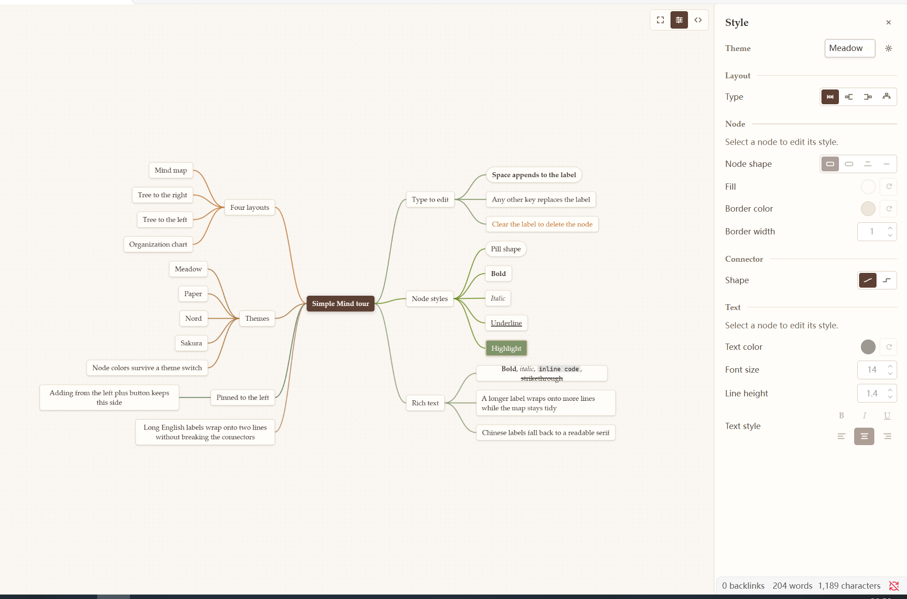
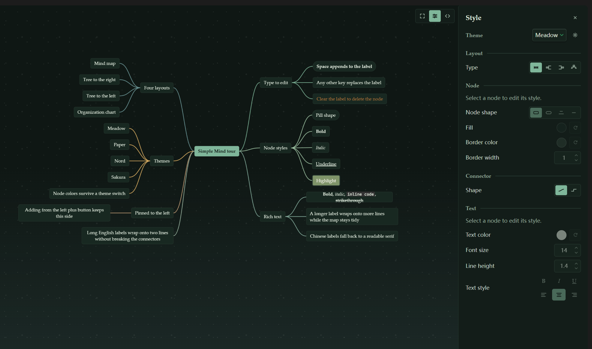

# Simple Mind

A Markdown-outline mind map editor for Obsidian.

[github.com/fickit/simple-mind](https://github.com/fickit/simple-mind)

> Status: 1.0.3. Free and open source. Desktop only; requires Obsidian 1.7.2 or newer.

Simple Mind turns a plain `.mindmap` file into a polished, interactive map — and keeps it a plain
Markdown outline underneath. No account, no network calls, no lock-in.



*Screenshot: the map view in the Meadow theme (light).*

## Why Simple Mind

- **Free, all of it.** Every layout, every theme, every style control. No paid tier, no feature
  locked behind a subscription.
- **Beautiful by default.** Nine hand-tuned themes, from a warm Natural Organic light mode to a
  moonlit-forest dark mode, and the map follows Obsidian's light/dark switch on its own.
- **Complete, not a toy.** Four layouts, inline editing, drag to reorganize, collapse, undo/redo,
  clipboard, per-node styling, a custom theme editor, and per-file view state.
- **Fast and quiet.** No network requests and no telemetry. Redraws are frame-batched and off-screen
  nodes are culled, so maps with hundreds of nodes stay responsive.
- **Your data stays yours.** A `.mindmap` file is Markdown plus a small frontmatter block; it opens
  in the source editor at any time and syncs like any other note.

## Features

### Maps that fit the way you think

- Four layouts: mind map, tree to the right, tree to the left, and organization chart.
- Inline editing, drag to reorganize, copy and paste subtrees, undo and redo.
- Collapse a branch into a count bubble; add buttons follow the layout and remember which side a
  branch belongs to.
- Each file remembers its pan, zoom, and selected node.


*Screenshot: mind map, tree to the right, tree to the left, and organization chart.*

### Styling without a design degree

- One style panel for the file's theme, layout, and connector shape, plus the selected node's shape,
  fill, border, and text styling (size, color, bold, italic, underline, alignment, line height).
- Nine built-in themes: Meadow, Obsidian Native, Paper, Graphite, Nord, Solarized, Forest, Ocean, and
  Sakura.
- A custom theme editor with a live preview, and theme import/export.
- Font family, connector color, and connector thickness are global defaults in the settings tab.


*Screenshot: the style panel open beside a selected node.*

### Small touches

- A floating menu over the canvas: fit to window, style panel, and source toggle.
- The style panel folds with an eased motion and the map frame is rounded against Obsidian's pane.
- English and Chinese interface.



*Screenshot: the same map in the moonlit-forest dark mode.*

## Usage

1. **Create a map.** Click the ribbon icon or run the **New mind map** command. An existing Markdown
   outline also works — just rename it to `.mindmap`.
2. **Type directly.** With a node selected, start typing:
   - **Space** starts appending to the current label.
   - **Any other character** replaces the label, starting with what you typed.
   - **Clear the whole label** and commit to delete the node (the root keeps at least one character).

   

   *Screenshot: editing a node in place while the rest of the map reflows around it.*
3. **Keys.**

   | Key | Action |
   | --- | --- |
   | `Tab` / `Enter` | Add a child / add a sibling |
   | `F2` or double-click | Edit the selected node |
   | `Delete` / `Backspace` | Delete the selected node, except the root |
   | Arrow keys | Move the selection |
   | `Ctrl/Cmd+Z`, `Ctrl/Cmd+Shift+Z` | Undo / redo |
   | `Ctrl/Cmd+C`, `X`, `V` | Copy, cut, paste |

4. **Style it.** Open the style panel from the floating menu and pick a theme, layout, and connector
   shape for the file, or restyle the selected node.
5. **Edit the source.** The source button switches the same tab to Obsidian's Markdown editor, and
   back to the map when you are done.

## Installation

Install from **Settings → Community plugins → Browse → Simple Mind** once the plugin is listed.

Manual install: download `main.js`, `manifest.json`, and `styles.css` from the latest release, put
them in `<vault>/.obsidian/plugins/simple-mind/`, then enable Simple Mind in the community plugins
settings.

## File format

A map is a Markdown outline with a small frontmatter block; per-node styles live inline, so the file
stays readable and diffs stay small.

```markdown
---
mindmap:
  theme: meadow
  layout: mindmap
  connectorStyle: curve
---

# Product plan
- Discovery
  - Interviews
  - Survey
- Launch <!-- sm:{"shape":"pill","bold":true} -->
```

## Compatibility

- Obsidian 1.7.2 or newer, desktop only.
- Light and dark follow Obsidian; every setting is stored in the vault's plugin data, never sent
  anywhere.

## License

MIT.
