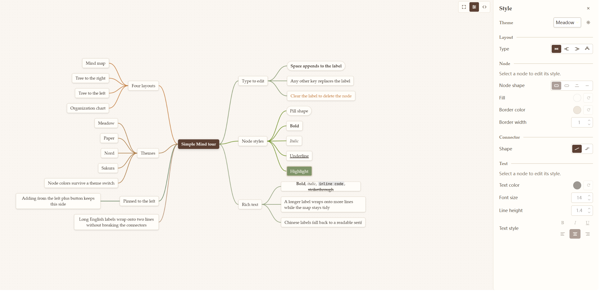
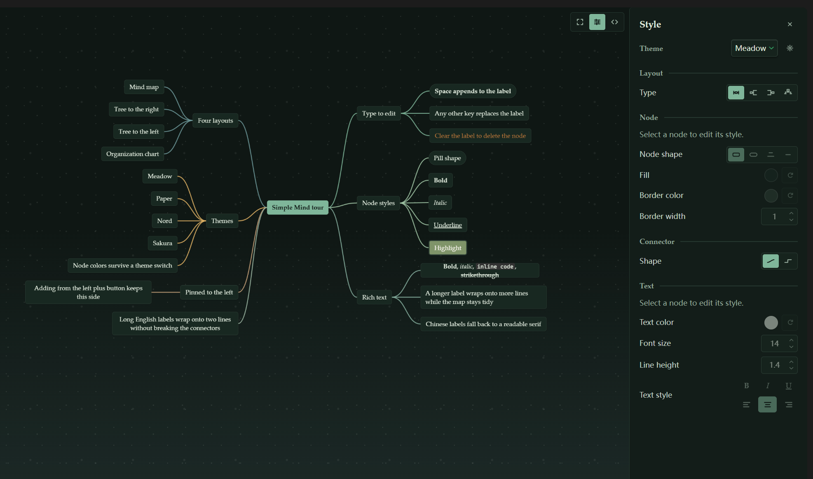

# Simple Mind

一个面向 Obsidian 的 Markdown 大纲思维导图插件。

[github.com/fickit/simple-mind](https://github.com/fickit/simple-mind)

> 状态：1.0.3

Simple Mind 把一个 `.mindmap` 文件变成精致、可交互的导图，底层仍然是一份普通 Markdown 大纲。
不需要账号、不联网、也没有格式锁定。






## 为什么选 Simple Mind

- **全部免费。** 四种布局、九套主题。
- **开箱就好看。** 九套手工调校的主题，从温暖的 Natural Organic 明亮模式到月光森林般的暗色模式；
  明暗随 Obsidian 自动切换。
- **功能齐全，不是玩具。** 四种布局、就地编辑、拖拽整理、折叠、撤销重做、剪贴板、单节点样式、
  自定义主题编辑器和按文件保存的视图状态。
- **快且安静。** 不发网络请求、不上报数据；重绘按帧合并、视口外节点自动裁剪，几百个节点的图依然流畅。
- **数据始终属于你。** `.mindmap` 就是 Markdown 加一小段 frontmatter，随时可以用源码编辑器打开，
  也能像普通笔记一样同步。

## 功能

### 贴合你的思考方式

- 四种布局：思维导图、向右树图、向左树图、组织架构图。
- 就地编辑、拖拽重排、子树复制粘贴、撤销重做。
- 折叠分支变成数量圆钮；添加按钮跟随布局方向，并记住分支所属的一侧。
- 每个文件记住自己的平移、缩放和选中节点。


### 不会设计也能调好样式

- 一个样式面板：文件级的主题、布局与连线形状，选中节点级的形状、填充、描边与文字样式
  （字号、颜色、加粗、斜体、下划线、对齐、行高）。
- 九套内置主题：Meadow、Obsidian Native、Paper、Graphite、Nord、Solarized、Forest、Ocean、Sakura。
- 自定义主题编辑器带实时预览，支持主题导入导出。
- 字体族、连线颜色与粗细在设置页作为全局默认值。


## 使用

1. **新建导图。** 点左侧图标或运行 **新建导图** 命令；已有的 Markdown 大纲把扩展名改成 `.mindmap`
   即可。
2. **直接打字。** 选中节点后：
   - 按 **空格**：在现有文字后面追加。
   - 输入 **任意其他字符**：以输入的字符替换原文字。
   - **清空全部文字**并提交：删除该节点（根节点至少保留一个字符）。

3. **常用按键。**

   | 按键 | 作用 |
   | --- | --- |
   | `Tab` / `Enter` | 添加子节点 / 添加兄弟节点 |
   | `F2` 或双击 | 编辑选中节点 |
   | `Delete` / `Backspace` | 删除选中节点（根节点除外） |
   | 方向键 | 移动选择 |
   | `Ctrl/Cmd+Z`、`Ctrl/Cmd+Shift+Z` | 撤销 / 重做 |
   | `Ctrl/Cmd+C`、`X`、`V` | 复制、剪切、粘贴 |

4. **调样式。** 从浮动菜单打开样式面板，为文件选主题、布局和连线形状，或单独调整选中节点。
5. **改源码。** 点源码按钮会在同一标签页切到 Obsidian 原生 Markdown 编辑器，改完再切回导图。

## 安装

插件上架后，在 **设置 → 第三方插件 → 浏览 → Simple Mind** 直接安装。

手动安装：从最新 Release 下载 `main.js`、`manifest.json`、`styles.css`，放进
`<库>/.obsidian/plugins/simple-mind/`，然后在第三方插件设置里启用 Simple Mind。

## 文件格式

导图就是一段 Markdown 大纲加一小段 frontmatter；节点样式写在行内，文件始终可读、diff 也保持干净。

```markdown
---
mindmap:
  theme: meadow
  layout: mindmap
  connectorStyle: curve
---

# 产品计划
- 调研
  - 访谈
  - 问卷
- 发布 <!-- sm:{"shape":"pill","bold":true} -->
```

## 兼容性

- Obsidian 1.7.2 或更新版本，仅桌面端。
- 明暗跟随 Obsidian；所有设置只存在库的插件数据里，不会发往任何地方。

## 许可

MIT。
