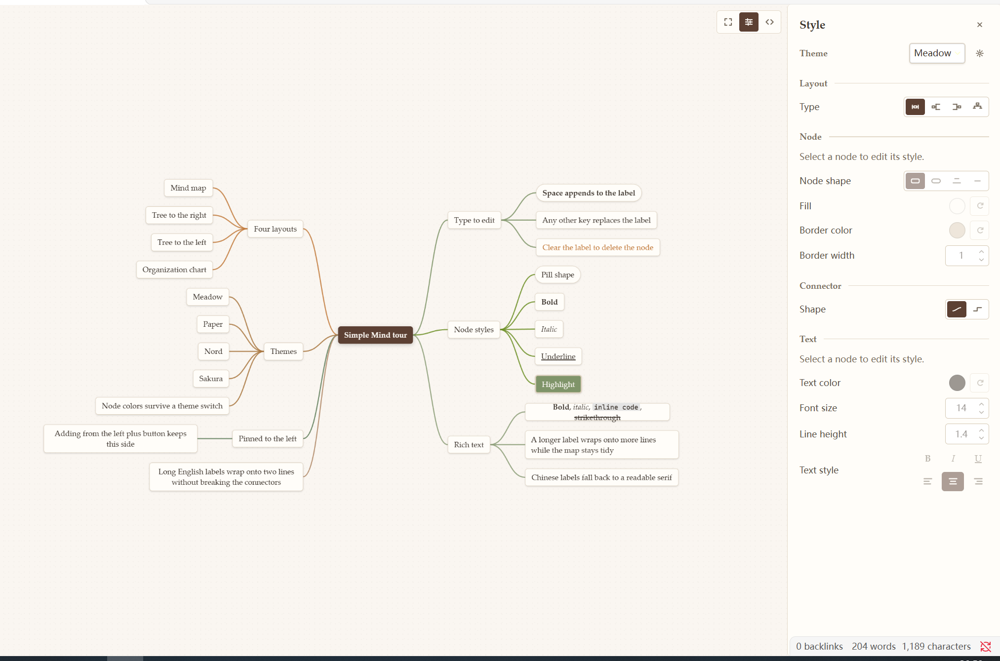
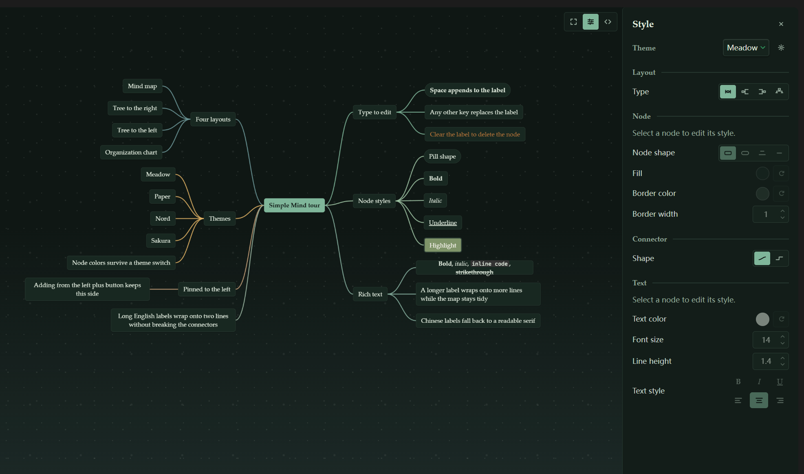

# Simple Mind

一个面向 Obsidian 的 Markdown 大纲思维导图插件。

[github.com/fickit/simple-mind](https://github.com/fickit/simple-mind)

> 状态：1.1.3

Simple Mind 把一个 `.mindmap` 文件变成精致、可交互的导图，底层仍然是一份普通 Markdown 大纲。
不需要账号，也没有格式锁定。






## 为什么选 Simple Mind

- **全部免费。** 四种布局、九套主题。
- **开箱就好看。** 九套手工调校的主题，从温暖的 Natural Organic 明亮模式到月光森林般的暗色模式；
  明暗随 Obsidian 自动切换。
- **功能齐全，不是玩具。** 四种布局、就地编辑、拖拽整理、折叠、撤销重做、剪贴板、单节点样式、
  行内图片与笔记链接、自定义主题编辑器和按文件保存的视图状态。
- **快且安静。** 不上报数据，插件自身也不发请求；重绘按帧合并、视口外节点自动裁剪，几百个节点的
  图依然流畅。你主动嵌入的外链图片由 Obsidian 的图片渲染器加载。
- **数据始终属于你。** `.mindmap` 就是 Markdown 加一小段 frontmatter，随时可以用源码编辑器打开，
  也能像普通笔记一样同步。

## 功能

### 贴合你的思考方式

- 四种布局：思维导图、向右树图、向左树图、组织架构图。
- 就地编辑、拖拽重排、子树复制粘贴、撤销重做。
- 折叠分支变成数量圆钮；添加按钮跟随布局方向，并记住分支所属的一侧。
- 支持多选：在空白画布上直接拖拽即可框选，框和拖过的节点会实时高亮；按住 Ctrl/Cmd/Shift 为
  追加选择。Alt+拖动平移画布；Ctrl/Cmd+A 全选，然后整组删除、复制或剪切。拖动根节点移动整张
  导图，拖动子节点到另一个节点上可重排。
- 每个文件记住自己的平移、缩放和选中节点。


### 和你的库连在一起

- 节点里直接写笔记链接和图片嵌入：`[[笔记]]`、`[[笔记|别名]]`、`![[photo.png]]` 或
  `![[photo.png|300]]`。
- 图片按缩略图显示，默认限高 140px；写 `|300` 可指定宽度。只包含图片的节点会去掉卡片底色和边框，
  直接以圆角图片作为节点。点击图片在全图浮层里查看大图。
- 笔记链接在新标签页打开，导图留在原处；鼠标悬停显示 Obsidian 原生页面预览。
- 编辑时输入 `[[` 或 ` 下载安装后，在字体
  族里填 `Kalam`。它不含中文字形。
- **杨任东竹石体**：免费可商用的手写中文字体，共 7 个字重。可从
  [猫啃网](https://www.maoken.com/freefonts/760.html) 或
  [free-font 索引](https://wordshub.github.io/free-font/font.html?YangRenDongZhuShiTi_Regular)
  获取。安装后在字体族里填系统字体列表显示的家族名（通常是 `杨任东竹石体`）。

先在操作系统里安装字体（Windows 右键 TTF 选“安装”；macOS 用“字体册”打开），再到
**设置 → Simple Mind → 默认字体** 中填写。新安装的字体没有出现时重启一次 Obsidian。两套字体都
免费可用，但转发字体文件前请确认各自的授权条款；插件本身不附带字体。

## 使用

1. **新建导图。** 点左侧图标或运行 **新建导图** 命令；已有的 Markdown 大纲把扩展名改成 `.mindmap`
   即可，也可以在任意笔记标签页右上角的三点菜单里选择 **以导图打开**。
2. **直接打字。** 选中节点后：
   - 按 **空格**：在现有文字后面追加。
   - 输入 **任意其他字符**：以输入的字符替换原文字。
   - **清空全部文字**并提交：删除该节点（根节点至少保留一个字符）。
   - **Shift+Enter** 在光标处换行；**Ctrl/Cmd+Enter** 提交本次编辑，但不新建节点。

3. **常用按键。**

   | 按键 | 作用 |
   | --- | --- |
   | `Tab` / `Enter` | 添加子节点 / 添加兄弟节点 |
   | `F2` 或双击 | 编辑选中节点 |
   | `Shift+Enter` | 编辑时在光标处换行 |
   | `Ctrl/Cmd+Enter` | 提交编辑，不新建节点 |
   | `Delete` / `Backspace` | 删除选中节点（根节点除外） |
   | 方向键 | 移动选择 |
   | `Ctrl/Cmd+B`、`I`、`U` | 选中节点加粗、斜体、下划线 |
   | `Ctrl/Cmd+Shift+L/E/R` | 选中节点左对齐、居中、右对齐 |
   | `Ctrl/Cmd+A` | 选中所有可见节点 |
   | 在空白画布上拖拽 | 框选节点；按住 Ctrl/Cmd/Shift 为追加 |
   | Alt + 拖动 | 平移画布 |
   | 拖动根节点 | 移动整张导图 |
   | 拖动子节点 | 拖到另一个节点上重排 |
   | `Ctrl/Cmd+Z`、`Ctrl/Cmd+Shift+Z` | 撤销 / 重做 |
   | `Ctrl/Cmd+C`、`X`、`V` | 复制、剪切、粘贴 |

4. **关联笔记和图片。** 编辑节点时输入 `[[` 搜索笔记，输入 `` 外链图片。
5. **调样式。** 从浮动菜单打开样式面板，为文件选主题、布局和连线形状，或单独调整选中节点。
6. **改源码。** 点源码按钮会在同一标签页切到 Obsidian 原生 Markdown 编辑器，改完再切回导图。

## 安装

插件上架后，在 **设置 → 第三方插件 → 浏览 → Simple Mind** 直接安装。

手动安装：从最新 Release 下载 `main.js`、`manifest.json`、`styles.css`，放进
`<库>/.obsidian/plugins/simple-mind/`，然后在第三方插件设置里启用 Simple Mind。

## 文件格式

导图就是一段 Markdown 大纲加一小段 frontmatter；节点样式写在行内，文件始终可读、diff 也保持干净。

```markdown
---
mindmap:
  theme: meadow
  layout: mindmap
  connectorStyle: curve
---

# 产品计划
- 调研
  - 访谈
  - 问卷
  - ![[现场记录.png|240]]
- 发布 <!-- sm:{"shape":"pill","bold":true} -->
- [[研究笔记]]
```

## 反馈

Simple Mind 完全免费开源，也靠真实使用它的导图成长。如果它对你的思考有帮助，给
[仓库](https://github.com/fickit/simple-mind) 点个 Star，让更多人找到它。

遇到问题或有想法，欢迎在 [Issues](https://github.com/fickit/simple-mind/issues) 提出来，附上
Obsidian 版本、复现步骤；能附一份最小的 `.mindmap` 文件或导图截图更好。功能建议、导图截图和
使用场景同样欢迎。

## 兼容性

- Obsidian 1.13.0 或更新版本，仅桌面端。
- 明暗跟随 Obsidian；所有设置只存在库的插件数据里，不会发往任何地方。插件自身不发网络请求，
  笔记链接和库内图片都留在本地；你主动嵌入的外链图片由 Obsidian 的图片渲染器加载。

## 许可

MIT。
